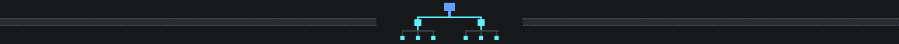

<p align="center">
  <picture><source media="(prefers-color-scheme: light)" srcset="assets/banner-light.svg"></picture>
</p>

<h1 align="center">agentVIEW</h1>

<p align="center"><b>A local workspace for seeing who is doing what.</b><br>
Intake agents, project coordinators and subagents, with durable conversations and read-only documents.</p>

<p align="center">
  <a href="https://github.com/undecuple/agentVIEW/actions/workflows/ci.yml"></a>
  <a href="LICENSE"></a>
  
  
</p>

<p align="center">
  <a href="#quickstart">Quickstart</a> · <a href="#status">Status</a> ·
  <a href="docs/agentview-preview.png">Screenshot</a> · <a href="#building">Build</a> ·
  <a href="https://github.com/undecuple/agentVIEW/issues">Report an issue</a>
</p>

agentVIEW is a Tauri 2 desktop app with a Rust core. It separates the agent workspace from a restricted document viewer.
The preview includes **simulated hierarchy/chat records** and a separate **Sessions** desk for explicitly launched Claude Code and Codex terminals. Authenticated native-TUI conversation recovery is awaiting live verification; see [session status and limits](docs/SHARED-SESSIONS.md). The Cyberdream dark/light design has [hierarchy](docs/agentview-preview.png), [Sessions](docs/agentview-live-preview.png) and [usage](docs/agentview-usage-preview.png) previews. [Dark Settings](docs/agentview-settings-dark-preview.png) · [Light Settings](docs/agentview-settings-light-preview.png).

The **Settings** page controls Molokai Dark, Cyberdream Light, PaperColor Light/Dark and System appearance, scale/density, startup defaults, terminal preferences, visible-page usage refresh and coordinator prompt presets. Preferences stay local; provider login/models/permissions remain native. See [settings and recovery](docs/SETTINGS.md).

## Quickstart

1. **Get the source.** Clone this repository, then enter its directory.
2. **Enter the pinned environment.** Run `nix develop`; the committed flake lock selects the toolchain and libraries.
3. **Start the app.** Run `CARGO_HOME="$PWD/.cargo-home" cargo run --locked -p agent-app`.
4. **Try a conversation.** Select an agent in Hierarchy, send a message, then restart. The conversation remains.
5. **Try the queue.** Set a simulated recipient to busy or paused, send a message, then resume it. Delivery continues in order.
6. **Open Sessions.** Select Claude Code or Codex, inspect the installed CLI, register an absolute project directory, review its resolved path/version, then start explicitly. Use native terminal prompts to log in or approve work. Closing the workspace stops owned processes; reopening requires an explicit exact-ID resume.

<p align="center"><picture><source media="(prefers-color-scheme: light)" srcset="assets/divider-light.svg"></picture></p>

## Status

As of **2026-11-22**, tested locally on Linux with WebKitGTK and a private X display:

| Area | Current state |
| --- | --- |
| Hierarchy | Separate Claude and Codex intake trees, project coordinators and subagents |
| Project view | Coordinators and their subagents grouped by project, with provider filters |
| Simulated conversations | SQLite persistence, ordered delivery, retry protection and restart recovery |
| Busy and paused demo agents | Messages remain queued until the recipient resumes |
| Documents | Allow-listed text, diffs, gate logs and raster images in a separate read-only window |
| Usage | Provider and agent views; input, output, cached input and total counts explicitly unavailable |
| Live sessions | Two app-owned Claude/Codex PTYs, separate provider IDs, explicit exact-ID resume and native login/approval UI; authenticated terminal recovery deferred |
| Coordinator prompts | Inbox/status/handoff presets and custom text paste into the selected terminal without Enter |
| Source and AppImage | Local source archives and unsigned Linux AppImage previews; no GitHub Release yet |
| CI | Locked Rust library tests, desktop compilation, Python tests and repository checks |

GUI checks exercised hierarchy filters, conversations, restart and the document-window command boundary.
AppImage smoke checks passed in Ubuntu 22.04 containers, with a negative control that rejects a process which exits immediately.
Native Wayland rendering, tiling and scaling were checked under isolated Niri. Live synthetic terminals also exercise 100/125/150/200% scaling and 640-pixel layouts; see [test scope and limits](docs/NIRI.md).
FUSE, other distributions and physical desktop interaction remain unvalidated.
The release workflow runs GUI and release-binary gates; dependency audit/deny remains unfinished.

**Known dependency issue:** `glib` 0.18.5 is affected by GHSA-wrw7-89jp-8q8g, concerning `VariantStrIter` iterators.
The direct project sources do not use that API; dependency call sites have not been checked.
The documented fix is in `glib` 0.20 or later and needs compatible Tauri/GTK dependency updates; advisory status has not been freshly rechecked.

## What goes online

The **Token usage** view stores numeric measurements in SQLite and reads matching app-managed session records only when you click **Refresh local usage**. It includes provider/session breakdowns and UTC daily reported subtotals. Claude input/cache counters are supported; Claude output/total remain unavailable until a reliable final-output source is established. New Codex sessions bind their exact rollout source; older records without that binding remain unavailable. Subscription limits and monetary spend are separate and unavailable. See [sources, bounds and verification](docs/USAGE.md).

The app has no network listener or app telemetry upload. Explicitly launched Claude Code and Codex use their native network, login, settings and tools; typing a prompt may incur the usage/billing configured in that CLI.
Simulated messages stay on the PC. The document viewer blocks external navigation and new windows.
Building may fetch pinned Nix inputs, locked crates, container packages and the hash-checked AppImage runtime.
The badge images on this README are loaded by GitHub and Shields.io, outside the desktop app.

## Where your data goes

- Conversations, demo agents and availability: `$XDG_DATA_HOME/agent-app/workspace.sqlite3`, falling back to `~/.local/share/agent-app/workspace.sqlite3`.
- Live launch metadata: a separate `sessions/sessions.sqlite3` under the same app data directory. Terminal output remains in bounded memory; provider conversation storage is managed by each native CLI.
- The app's data directory must be owned by you and private (mode `700`). It is separate from allow-listed documents.
- Viewer configuration: `~/.config/agent-app/allowlist.toml`. Use [the example](allowlist.example.toml); both the file and its directory must be owned by you and not group/other writable.
- The app does not store provider credentials. Pattern redaction is best effort; keep secrets out of allow-listed files and conversations.

<p align="center"><picture><source media="(prefers-color-scheme: light)" srcset="assets/divider-light.svg"></picture></p>

## Getting it

This is a source-first preview. There is no published GitHub Release, installer signature or automatic updater.
Build locally using the commands below. Source archives contain committed files, excluding local state and caches.
AppImage filenames include the source commit; each artifact has a SHA-256 file. A checksum verifies integrity, not authenticity.
The [release workflow](docs/RELEASING.md) provides manual artifact builds and draft releases for validated version tags. Adding the workflow does not publish a release.

## Requirements

- Linux x86_64. AppImage builds require glibc **2.34 or newer**.
- System **WebKitGTK 4.1 and GTK 3**; the portable build does not bundle them. (A local NixOS standalone build that does bundle them exists: `docs/STANDALONE-NIXOS.md`; it is not published.) Keep them patched through your distribution.
  Debian/Ubuntu: `libwebkit2gtk-4.1-0 libgtk-3-0`; Fedora: `webkit2gtk4.1 gtk3`; Arch: `webkit2gtk-4.1 gtk3`.
- Normal AppImage mounting needs FUSE 3 (`fusermount3`). Without it, use `--appimage-extract-and-run`; only that mode has been tested.
- Live terminals: installed Claude Code (`--session-id`/`--resume`) or Codex with compatible native resume/app-server support, with native login configured by the user. No CLI binary or provider login is bundled.
- Development: Nix with flakes enabled. Packaging also needs rootless Podman and access to the required images and locked crate cache.

## Building

```sh
nix develop
export CARGO_HOME="$PWD/.cargo-home"
cargo run --locked -p agent-app
```

Run the complete local foundation checks:

```sh
nix develop --command bash scripts/check-foundation.sh
```

The helper saves full logs and desktop screenshots in a fresh temporary directory and prints a short summary.
It uses synthetic data on a private X display. See [the implementation and validation notes](docs/FOUNDATION.md).

Build artifacts from a clean committed tree:

```sh
nix develop --command bash scripts/package-source.sh
nix develop --command bash scripts/build-appimage.sh
nix develop --command bash scripts/test-appimage.sh
```

Outputs and SHA-256 files go into ignored `dist-appimage/`; previous outputs are preserved.
On rootless Podman hosts without subordinate UID mappings, set `AGENT_APP_CONTAINER_USERNS=host` for the AppImage build and test commands.
This uses the existing rootless namespace; it does not grant host root privileges.

Regenerate or verify the deterministic icon and repository art:

```sh
nix develop --command python3 scripts/make-icon.py --check
nix develop --command python3 scripts/make-readme-assets.py --check
```

Omit `--check` to regenerate. Both generators use embedded geometry, no font downloads or external image services.
The social preview is [assets/social-preview.png](assets/social-preview.png), with a [matching light variant](assets/social-preview-light.png), 1280×640 and under 1 MB.

<p align="center"><picture><source media="(prefers-color-scheme: light)" srcset="assets/divider-light.svg"></picture></p>

## How it works

- **Hierarchy:** provider intake → project coordinator → subagent, with parent relationships and availability shown explicitly.
- **Workspace:** a Rust library owns SQLite records and transactional simulated delivery. The UI sends narrowly scoped commands.
- **Documents:** a separate window retains the path allow-list, navigation restrictions and restrictive content policy. It cannot invoke workspace mutations.
- **Usage:** provider totals and agent rows distinguish unavailable telemetry from measured counts. Subscription limits and API spend are separate.
- **Packaging:** the AppImage uses the host browser libraries, includes dependency licences and records its source commit.

The AppImage type2 runtime is a third-party binary, release `20251108`, pinned to SHA-256:
`2fca8b443c92510f1483a883f60061ad09b46b978b2631c807cd873a47ec260d`.
It is not built from source here and its signature has not been verified. See [NOTICE.md](NOTICE.md).

## How AI was used

Developed with AI agent assistance under the maintainer's direction. Changes are checked locally before publication.

## Roadmap

Next: verify authenticated native-TUI recovery, then durable jobs and revision-aware document reviews. Native Claude settings/approvals remain authoritative.
Live token telemetry needs separate provider adapters; unknown values will remain explicit until supported data exists.
The project's wish list includes a Web UI and a possible Android client reaching PC-hosted sessions over NetBird. Those clients and any listener are future work.
The [sandbox/activity proposal](docs/SANDBOX-ACTIVITY-DESIGN.md) covers Bubblewrap inspection, blocked actions, approval/recovery controls and when PostgreSQL would become useful.
Instructions & Skills will include a [central onboarding document](docs/CENTRAL-ONBOARDING-DESIGN.md) for shared global rules, linked by Codex and Claude with approved, versioned edits.
The [database design](docs/DATABASES-DESIGN.md) covers SQLite operational state, optional DuckDB analytics and scoped project database access for coordinators.
The [integration plan](docs/INTEGRATIONS.md) covers real CLI resume/attach, Prometheus/Grafana and install-aware tool update reminders.
The [credential-management design](docs/VAULT-DESIGN.md) adds a planned vault and explicit project/coordinator/subagent access grants for SSH identities and API tokens.

## Related projects

- **[Cyberdream](https://github.com/scottmckendry/cyberdream.nvim):** dark/light color palette inspiration, adapted for app readability; MIT attribution retained.
- **[undecuple/me](https://github.com/undecuple/me):** status site and visual inspiration for the double rules, dither and framing. agentVIEW has its own lettering, hierarchy dividers and palette.
- **[Tauri](https://github.com/tauri-apps/tauri):** desktop shell and platform webview integration.
- **[SQLite](https://sqlite.org/):** local transactional storage for the workspace.

## Official channels

The project repository is [undecuple/agentVIEW](https://github.com/undecuple/agentVIEW), maintained through the [undecuple account](https://github.com/undecuple).
Use its issues for feature requests and bug reports. No other download channel is announced here.

<p align="center"><picture><source media="(prefers-color-scheme: light)" srcset="assets/divider-light.svg"></picture></p>

## Contributing

See [CONTRIBUTING.md](CONTRIBUTING.md). Report security issues through [SECURITY.md](SECURITY.md).
Keep fixtures synthetic and changes scoped; include the checks you actually ran.

## Repository layout

```text
core/        Read-only document policy and routing
workspace/   Simulated hierarchy, conversations and SQLite persistence
sessions/    Provider-aware PTYs and durable native launch identities
ui/          Workspace interface and original icon
src-tauri/   Desktop shell and command boundary
viewer/      Python document viewer
scripts/     Checks, packaging and deterministic art generators
assets/      README banner, hierarchy divider and social preview
docs/        Design, validation, screenshot and wishlist
licenses/    Third-party licence texts
```

## Licence

Project code, documentation and original artwork: **MIT**, see [LICENSE](LICENSE).
Third-party components and credits: [NOTICE.md](NOTICE.md), with full texts under [licenses/](licenses/).
