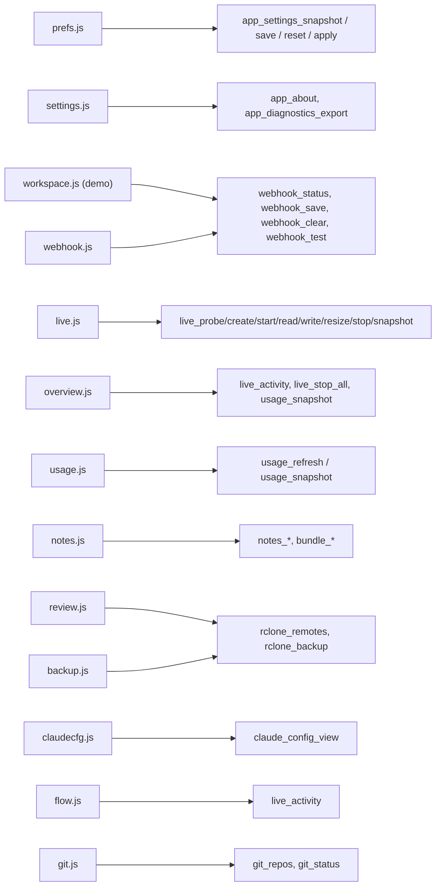

# Tauri commands and capabilities

There are **78 commands**. Five lists must agree, and the GUI test checks the last one:

1. `#[tauri::command]` functions in `src-tauri/src/*.rs`
2. `tauri::generate_handler![...]` in `src-tauri/src/main.rs`
3. `AppManifest::commands(&[...])` in `src-tauri/build.rs`
4. `allow-<name>` entries in `src-tauri/capabilities/workspace.json` (the only capability file; window `workspace`)
5. the denied-command probe in `src-tauri/src/workspace_e2e.rs`, which expects `denied=78`; `scripts/test-workspace.sh` mirrors the number as `docs-denied=78`

`src-tauri/permissions/autogenerated/` holds one generated `<name>.toml` per command and is regenerated by the build.

## Adding a command

1. Write the `#[tauri::command]` function and start it with `authorized(&window)?` (or use `with_store`, `manager` or `usage_view`, which call it first).
2. Register it in `generate_handler!` in `main.rs`.
3. Add its name to `build.rs`.
4. Add `allow-<name>` (dashes) to `capabilities/workspace.json`.
5. Add a call to the denied probe in `workspace_e2e.rs` and raise the count in `workspace_e2e.rs` and `scripts/test-workspace.sh`.

Then rebuild with `--features workspace-e2e` (the test JavaScript is embedded at compile time) and run the workspace GUI test.

## The window rule

`authorized()` (in `main.rs`) calls `agent_app_workspace::trusted_window(label, url)`, which is true only for label `workspace` and URL `workspace://localhost/`. `with_store` runs `authorized` and then locks the workspace `Store`. `live.rs` has two helpers that also authorize first: `manager()` (the session manager) and `usage_view()` (a second connection for usage).

## The 78 commands

Gate column: **S** = `with_store`, **A** = direct `authorized`, **M** = `manager()`, **U** = `usage_view()`.

| Group | Command | File | Gate | What it touches |
|---|---|---|---|---|
| Demo workspace | `workspace_snapshot` | main.rs | S | reads `agents`, `messages` |
| | `workspace_send` | main.rs | S | inserts a message |
| | `workspace_control` | main.rs | S | sets an agent's availability |
| | `workspace_tick` | main.rs | S | delivers queued demo messages |
| | `workspace_open_docs` | main.rs | A | opens or focuses the document window |
| Sessions | `live_probe` | live.rs | A, M | runs `<cli> --version` and `--help`; configures the manager |
| | `live_snapshot` | live.rs | M | lists sessions |
| | `live_create` | live.rs | A, M | registers a session in a project folder |
| | `live_set_remote` | live.rs | M | Remote Control flag (Claude) |
| | `live_rename` | live.rs | M | session label |
| | `live_remove` | live.rs | M | forget a registered project (app record only; refused while running) |
| | `docs_list` | docshare.rs | | shared folders and files, the files they list, the fixed deny names |
| | `docs_check` | docshare.rs | | resolve a typed path and say what would be shared; writes nothing |
| | `docs_add` | docshare.rs | A | share the reviewed path (must equal what `docs_check` showed); writes only the app's own list |
| | `docs_remove` | docshare.rs | A | stop sharing; never touches the shared files |
| | `docs_read` | docshare.rs | | read one shared text file (256 KB cap, no binary, no images), rendered by the safe renderer |
| | `live_activity` | live.rs | M | per-session state, byte counters, latest tool name |
| | `live_stop_all` | live.rs | M | stops every running session |
| | `live_start` | live.rs | M | spawns the CLI in a pseudo-terminal |
| | `live_read` | live.rs | M | reads terminal output (base64) |
| | `live_write` | live.rs | M | writes terminal input |
| | `live_resize` | live.rs | M | resizes the terminal |
| | `live_stop` | live.rs | M | stops one session |
| Usage | `usage_snapshot` | live.rs | U | saved numeric readings |
| | `usage_refresh` | live.rs | U | re-reads provider session records, saves counters |
| Pre-PR review | `review_files` | review.rs | A | queue of allow-listed drafts with status |
| | `review_load` | review.rs | A | rendered draft and its label state |
| | `review_mark` | review.rs | A | saves PASS (manual review) bound to the file hash |
| | `review_clear` | review.rs | A | removes the label |
| Notes | `notes_list` | notes.rs | S | search and list pages |
| | `notes_get` | notes.rs | S | one page with its revision list |
| | `notes_save` | notes.rs | S | create or save; refuses a stale save |
| | `notes_delete` | notes.rs | S | deletes a page and its revisions |
| | `notes_revision` | notes.rs | S | text of an earlier version |
| | `notes_render` | notes.rs | A | safe Markdown preview (pure) |
| Claude config | `claude_config_view` | claude_config.rs | A | read-only redacted view of the Claude Code state file |
| Backup | `rclone_remotes`, `rclone_backup` | rclone.rs | A | list rclone remote names; dry-run then confirmed `rclone copy` of the exports folder only |
| Claude hook | `claude_hook_status` | hooksignal.rs | A | snippet for the user's own Claude Notification hook, last signal seen; the app only reads the private signal file |
| Codex hook | `codex_hook_status` | hooksignal.rs | A | snippet for the user's own Codex `notify` setting (turn complete), last signal seen; read-only |
| Files accessed | `files_access_status`, `files_access_report` | filesaccess.rs | A | snippet for the user's own Claude PostToolUse hook; newest file reads and writes the hook logged (denied names shown as hidden, paths redacted); read-only |
| Needs you | `attention_list` | notify.rs | A | recent quiet, error and hook-waiting lines the monitor saw (in memory, 6 h) |
| Plan limits | `claude_limits_status` | limits.rs | A | reads the small file a status line script writes from Claude Code's `rate_limits`; sets the alert percentage; never reads credentials |
| Session changes | `session_changes` | live.rs / gitview.rs | A | changed files and commits since start in one session's repository; fixed read-only git status and log |
| Timeline | `timeline_list` | notify.rs | A | in-memory state changes of sessions (started, quiet, active again, ended), 24 h |
| Project files | `project_file_preview`, `project_file_write` | projwrite.rs | A | consent-gated write of CLAUDE.md, AGENTS.md, HANDOFF.md or BOARD.md into a registered session's folder: preview with hash, explicit confirm, optional backup into the app's `backups/` folder, atomic replace; no links, fixed names |
| Project board | `kanban_projects`, `kanban_board`, `kanban_alert` | kanban.rs | A | per-project board read from `kanban/<project>.jsonl` (agents append lines; newest line per card wins; five fixed columns); update snippet and agent instruction text |
| Away mode | `away_status` | away.rs | A | turn away mode on/off (app-owned flag file and instruction text), mark parked questions seen; lists the questions agents parked in `decisions/pending.jsonl`; hook snippet and instruction |
| Queues | `queues_view` | queues.rs | A | read-only view of resource queues (running, waiting in order, reserved, over-estimate marker) folded from `queues/<name>.jsonl`; written by a scheduler or `scripts/adapters/lockdir-queue.sh` |
| Mailbox | `mailbox_status`, `mailbox_list` | mailbox.rs | A | snippets for sending to and receiving from the agent mailbox (one JSONL file in the app's `mailbox/` folder, read-only for the app); recent messages |
| Desktop notify | `desktop_notify` | notify.rs | A | read, switch on or off, or test one fixed `notify-send` call; flag file in the app data folder |
| Claude settings | `claude_settings_view`, `claude_inventory` | claude_settings.rs | A | read-only permissions, hooks, env names; skills, commands and agents (names and descriptions) |
| Claude memory and history | `claude_memory_list`, `claude_memory_read`, `claude_sessions_list` | claude_memory.rs | A | read-only memory notes, CLAUDE.md and AGENTS.md (allow-list and deny names apply); past-session file names, sizes and times only |
| Time | `time_report` | timelog.rs | A | per-project running and active time from the app's own daily totals |
| Notifications | `webhook_status`, `webhook_save`, `webhook_clear`, `webhook_test` | notify.rs | A | up to five https webhook destinations with events (addresses never returned to the page); fixed `curl` call; test message |
| Git | `git_repos`, `git_status` | gitview.rs | A | read-only status of repositories containing an allow-listed path; fixed `git` argument lists |
| Bundles | `bundle_export` | bundle.rs | S | writes a bundle file in the private exports folder |
| | `bundle_list` | bundle.rs | A | lists bundle files there |
| | `bundle_preview` | bundle.rs | A | validates and summarises one bundle |
| | `bundle_import` | bundle.rs | A, S | adds pages; replaces preferences only if asked |
| Settings | `app_settings_snapshot` | settings.rs | S | preferences and recovery state |
| | `app_settings_save` | settings.rs | S | validated save with revision check |
| | `app_settings_reset` | settings.rs | S | restore defaults |
| | `app_settings_apply` | settings.rs | S | applies interface scale to the webview |
| | `app_about` | settings.rs | S | version, directories, saved CLI versions |
| | `app_diagnostics_export` | settings.rs | A | writes a small diagnostic report to the exports folder |

## Which page calls which command

`live.js` also reaches `live_rename`, `live_set_remote` and other session changes through its `mutate('<command>', args, message)` helper, so a plain search for `invoke('name')` misses them. Search for the bare command name in `ui/` before deciding a command is unused.
