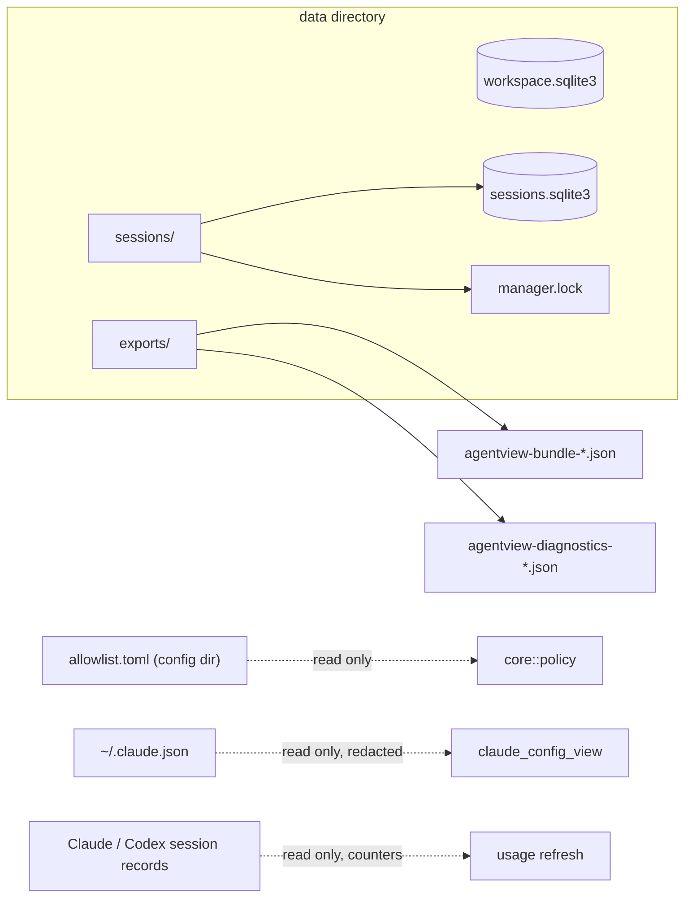

# Data stores

Everything the app writes sits in its own data directory (`$XDG_DATA_HOME/agent-app`, else `~/.local/share/agent-app`). It is created with mode 0700 and must be absolute, a real directory, owned by you and closed to group and others, or storage refuses to start. Debug builds honour `AGENT_APP_DATA_DIR` and `AGENT_APP_CONFIG`; release builds ignore them.

## workspace.sqlite3 (owner: `workspace::Store`)

One connection behind a mutex. Opened without following symlinks, with a 5 s busy timeout and foreign keys on. Open runs in an immediate transaction and refuses a newer schema (`user_version` above 2). The journal mode is not changed from SQLite's default.

| Table | Purpose | Limits and notes |
|---|---|---|
| `agents` | simulated roster (demo only; 14 seeded agents) | hierarchy validated on open |
| `messages` | simulated conversations | body 8000 bytes, pages of 100, unique `request_id` for idempotent sends |
| `app_settings` | preferences as one JSON row | revision-checked saves, 256 KiB cap |
| `app_settings_recovery` | copy of a bad settings row before an explicit reset | |
| `manual_reviews` | the user's own PASS (manual review) label per file | bound to the content hash; stale when the file changes; not an approval |
| `notes` | Notes library pages | 2000 pages, 256 KiB each, stale saves refused |
| `note_revisions` | earlier text of a page | last 20 per page |

## sessions/sessions.sqlite3 (owner: `sessions::SessionManager`)

- `manager.lock` takes an exclusive file lock for the life of the manager so only one app instance owns the store.
- A second connection (`UsageView`, used by `usage_snapshot` and `usage_refresh`) has no lock and runs no migration, and it has its own mutex so a slow usage refresh never blocks terminal reads. It only writes `usage_readings`.
- Migrations are tracked by `user_version` (now 3); later columns (`remote_control`, `exit_info`, `exit_at`) are added by checking `pragma_table_info`. Open refuses a newer schema. On open, `running` and `launching` become `interrupted` and `bootstrapping` becomes `bootstrap_unknown`; nothing is relaunched and no input is replayed.

| Table | Purpose |
|---|---|
| `sessions` | up to 64 registered sessions: label, folder, executable identity, provider, provider session id, status, Remote Control flag, exit status and time |
| `usage_sources` | binds a Codex session to its record file |
| `usage_readings` | numeric counters per session, with source identity and a status such as `ok`, `partial`, `identity_mismatch`, `counter_reset` or `too_large` |

## Files the app writes

Only under `exports/`, with mode 0600 and create-new:

- `agentview-bundle-<seconds>-<pid>.json`: preferences and notes, with a SHA-256 integrity value (up to 24 MiB). Note text is exported as stored, without redaction, so do not keep secrets in notes or quick prompts.
- `agentview-diagnostics-<nanos>-<pid>.json`: a small projected report (up to 16 KiB).

The only browser-side storage is the sidebar-collapse flag in `localStorage`.

## Read-only sources

- **Allow-list** (`allowlist.toml` in the config directory): must be a plain file owned by you, not group or other writable, up to 1 MB. Keys: `allow`, `deny_names`, `gate_file`. It is read once at startup, so edits need a restart. If it fails to load the app falls back to an empty allow-list and shows a banner.
- **Claude Code state file** (`~/.claude.json`): shown as structure only (folders, trust flags, counts, MCP server names with a command name or host). Never returns environment values, arguments, headers, tokens, account details or history text, and never writes.
- **Provider session records**: read for numeric usage and, for Claude, the name of the latest tool. Files must be owned by you, not group or other writable and not hard-linked; the path is derived from the stored session id only; size and per-refresh budgets apply.

## In-memory state (lost on exit)

- Terminal output: a ring buffer of 256 KiB per running session (at most 2 running). Reads return up to 64 KiB and report `truncated` if the offset fell out of the buffer; writes are at most 16 KiB. Terminal content is never saved.
- `LiveState` (the session manager and the usage connection), `WorkspaceState` (the store) and the parsed allow-list.

## Path policy and redaction (`core::policy`)

A path is accepted only if it passes these steps in order: no NUL byte; canonicalised (symlinks followed); valid UTF-8; not under `/proc`, `/sys` or `/dev`; no component matches the deny list (33 built-in patterns plus `*.iso` and any `deny_names`; case-insensitive; config can only add); inside an allow root or equal to an allowed file. Reads open beneath the allow root with `openat2` (no symlinks, no magic links), re-check device and inode, and refuse hard-linked files.

`redact()` replaces obvious token shapes (private-key headers, `ghp_`-style, `github_pat_`, `sk-`, `AKIA`, `xox*-`, `Bearer …`, and quoted `key/secret/password/token` values of 12 or more characters) with `[redacted]`. It is best effort; the deny list is the main control. It is applied to demo messages on write and read, and to rendered views (review, notes preview, viewer pages). It is not applied to stored notes or bundles.
