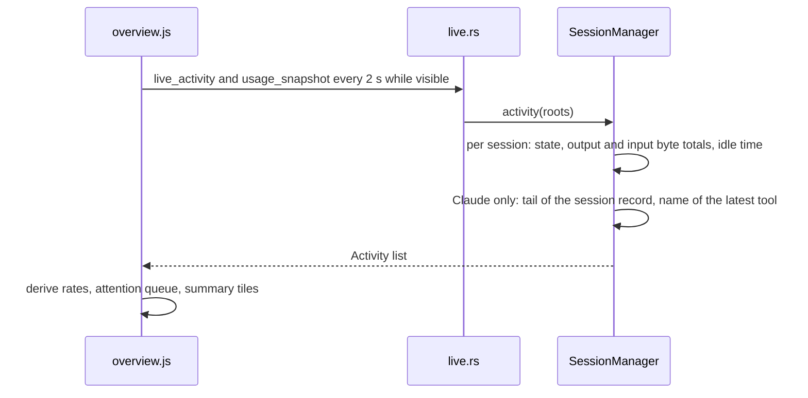
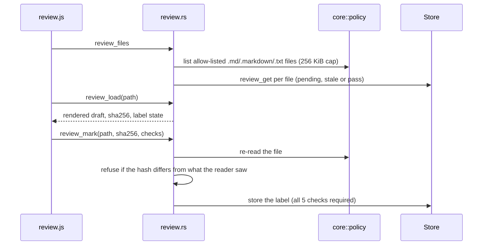

# Runtime flows

Sequence diagrams of the main paths. "Shell" is `src-tauri`. Every command first checks that the caller is the workspace window (see [COMMANDS.md](COMMANDS.md)).

## 1. App start

```mermaid
sequenceDiagram
  participant M as main()
  participant C as core::Config
  participant S as workspace::Store
  participant W as workspace window
  M->>C: load allow-list (empty list and a banner on error)
  M->>S: Store::open(data dir / workspace.sqlite3)
  Note over S: immediate transaction, refuse newer schema,<br/>seed roster, create settings, reviews and notes tables
  M->>M: manage(LiveState::default()), no session manager yet
  M->>M: register commands and the workspace and viewer schemes
  M->>W: build window at workspace://localhost/ (new windows denied, navigation restricted)
  W->>M: prefs.js calls app_settings_snapshot
  W->>W: AppNav.navigate(default page; agents falls back to sessions)
```

A store error is kept in state and reported to the UI; it does not abort startup. The document window is not created at start: `workspace_open_docs` builds it on demand.

## 2. Live session: start and terminal output

```mermaid
sequenceDiagram
  participant UI as live.js
  participant L as live.rs
  participant SM as SessionManager
  participant P as CLI in a pty
  UI->>L: live_probe(provider)
  L->>SM: version and help checks, configure_provider
  UI->>L: live_create(provider, label, folder)
  L->>SM: create_for (limit 64 sessions)
  UI->>L: live_start(id)
  SM->>SM: checks: limits (2 running), executable identity, recipe, folder
  SM->>P: spawn in a pty (Claude: --session-id or --resume; Codex: resume --no-daemon)
  loop poll 120 ms, backing off to 1 s when idle, paused when hidden
    UI->>L: live_read(id, generation, offset)
    L->>SM: read from the ring buffer (max 64 KiB)
    SM-->>UI: base64 bytes, next_offset, truncated, running
  end
  UI->>L: live_write / live_resize
  UI->>L: live_stop(id)
  SM->>P: SIGTERM to the group, then SIGKILL after 250 ms
```

When a child exits, `refresh()` records the exit status (`exit N` or `signal N`) and marks the session `exited`. Starting again clears it. Closing the workspace window sets `closing`, stops all children and ends sessions as `stopped` (Codex sessions mid-bootstrap become `bootstrap_unknown`).

## 3. Usage refresh

```mermaid
sequenceDiagram
  participant UI as usage.js
  participant L as live.rs usage_view
  participant UV as UsageView (own connection and mutex)
  participant F as provider session record
  UI->>L: usage_refresh (button or timed, only while visible)
  L->>L: ensure main manager exists (migrations and lease)
  L->>UV: refresh_usage(roots)
  loop each registered session
    UV->>F: open by derived path, check owner, mode, links
    UV->>UV: compare identity with last reading; parse counters
    UV->>UV: upsert usage_readings (status, totals, daily)
  end
  UV-->>UI: snapshot of saved readings
```

Refresh is cancellable and has a total byte budget. Failures are stored as a status, never as zero usage.

## 4. Overview polling



The attention queue flags sessions that ended with a non-zero exit or a signal, were interrupted, have unknown bootstrap, or are running with no output for over 10 minutes. "Stop all running" asks for a second click and then calls `live_stop_all`.

## 5. Pre-PR review marking



The label is the reader's own note tied to one exact file text. It approves nothing.

## 6. Notes and bundles

```mermaid
sequenceDiagram
  participant UI as notes.js
  participant N as notes.rs / bundle.rs
  participant S as Store
  participant X as exports folder
  UI->>N: notes_render(text) after 250 ms
  UI->>N: notes_save(id, shelf, title, body, base_updated)
  N->>S: transaction: refuse if updated differs; keep old text as a revision; keep last 20
  UI->>N: bundle_export
  N->>S: read preferences and all pages
  N->>X: write agentview-bundle-*.json (0600, create-new, SHA-256)
  UI->>N: bundle_list / bundle_preview(name)
  N->>X: read by listed name only (no symlinks, size cap, integrity check)
  UI->>N: bundle_import(name, include_settings)
  N->>S: add pages as new (clash gets " (imported)"); replace preferences only if asked
```
