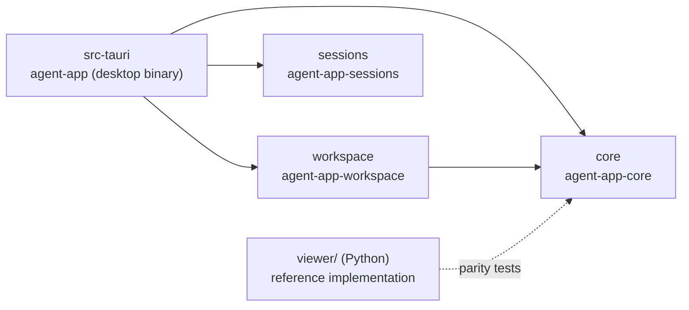
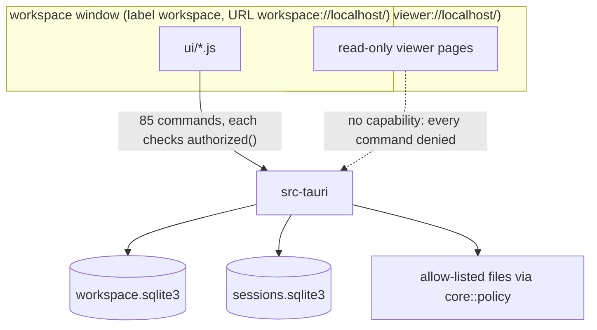

# Code map

A guide for people changing agentVIEW. Every number here was counted from the code; the build and test notes say what to run for each kind of change. Diagrams are Mermaid and render on GitHub.

| Page | What it covers |
|---|---|
| [COMMANDS.md](COMMANDS.md) | All 40 Tauri commands, the window rule, and the five edits a new command needs |
| [FRONTEND.md](FRONTEND.md) | Pages, scripts, shared helpers, themes, how assets are embedded and served |
| [DATA.md](DATA.md) | The two SQLite databases, files the app writes, read-only sources, in-memory state, redaction |
| [FLOWS.md](FLOWS.md) | Sequence diagrams: app start, live session and terminal reads, usage refresh, overview polling, review, notes and bundles |
| [BUILD-TEST.md](BUILD-TEST.md) | Scripts, GUI tests, test environment variables, CI, packaging, and what to run for which change |

## Crates

The workspace has four Rust crates (`Cargo.toml`, resolver 2) plus a Python reference viewer.

| Crate | Purpose | Key items |
|---|---|---|
| `core` | Read-only path policy, redaction, Markdown renderer, image checks, gate-log parser, and the `viewer://` HTTP router. No workspace dependencies. Only `sys.rs` may use unsafe code (`openat2`, `geteuid`). | `policy::{Config, check_path, read_bytes, redact}`, `router::handle`, `markdown::{render, sha256_hex}`, `images`, `gate::pending` |
| `sessions` | Claude Code and Codex CLI sessions in a pseudo-terminal, kept in SQLite, plus usage reading and activity. No workspace dependencies. Linux only. | `SessionManager`, `UsageView`, `Activity`, limits `MAX_SESSIONS` 64, `MAX_ACTIVE` 2, `RING_BYTES` 256 KiB |
| `workspace` | The app's own SQLite store (demo roster and messages, settings, review labels, notes) and the static assets plus content-security policy of the workspace window. | `Store`, `asset()`, `CSP`, `trusted_window()`, `notes`, `reviews`, `settings` |
| `src-tauri` | The Tauri shell: registers the 85 commands and the two URI schemes, creates windows, wires the other crates together. | `main.rs`, `live.rs`, `settings.rs`, `review.rs`, `notes.rs`, `bundle.rs`, `claude_config.rs`, `gitview.rs`, `rclone.rs`, `notify.rs`, `timelog.rs`, `hooksignal.rs`, `background.rs`, `tasks.rs`, `limits.rs`, `projwrite.rs`, `claude_settings.rs`, `claude_memory.rs` |

## Trust boundary

Only the window labelled `workspace` at exactly `workspace://localhost/` may call commands. The capability file lists `workspace` as its only window, so the document viewer window has no command access at all; a probe in the GUI tests asserts this.
